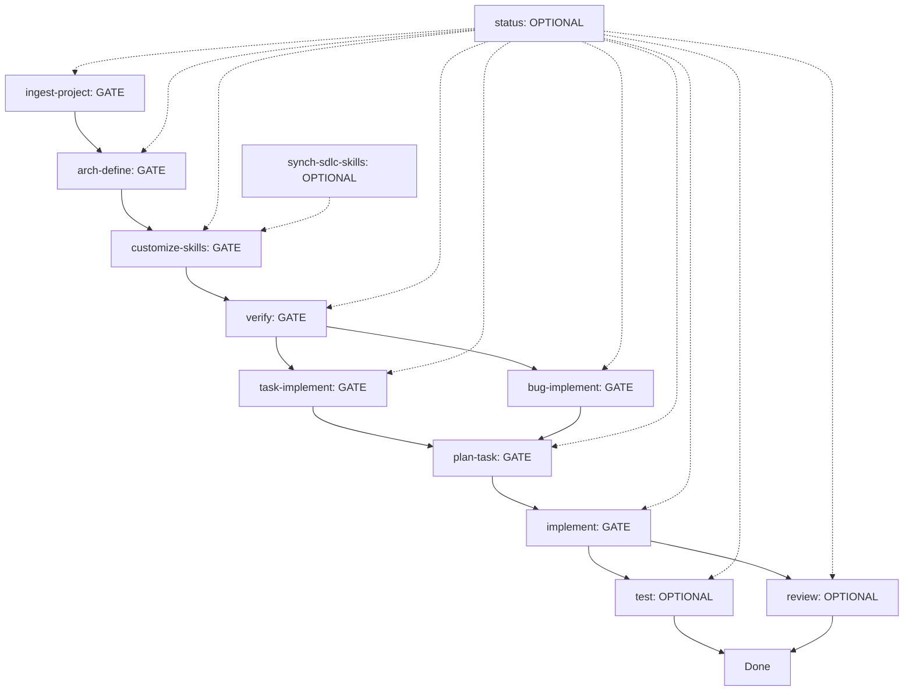

# Harness Flow Builder

A markdown-driven SDLC harness for AI agents (or humans) working on any software project. Every skill has a `SKILL.md`, an input template, and an output template.

## Overview

Harness Flow Builder provides a structured, repeatable workflow for software development lifecycle (SDLC) tasks. It uses a gate-based flow where each phase must complete successfully before the next begins, ensuring quality and consistency across projects.

### Key Concepts

- **GATE**: Required phases that must complete before proceeding. Failure means stay, fix input, retry.
- **OPTIONAL**: Phases that may be skipped; log the reason in `.harness/current.md`.
- **Two-tier skills**:
  1. **COMMON** → `skills/sdlc-*/SKILL.md` (contain `{{TOKENS}}` for templating)
  2. **PROJECT** → `./wiki/.harness/skills/sdlc-*/SKILL.md` (rendered copies with tokens substituted)

---

## Flow



### Phase Details

| Phase | Type | Description |
|-------|------|-------------|
| `ingest-project` | GATE | Scan project or use description → `wiki/project.md` + `wiki/features/*.md` |
| `arch-define` | GATE | Define architecture, tech stack, module map → `architecture.md` + `project_profile.md` |
| `customize-skills` | GATE | Render common skills with project tokens → `./wiki/.harness/skills/sdlc-*/SKILL.md` |
| `verify` | GATE | Validate wiki artifacts → `wiki/reports/verify_*.md` |
| `task-implement` | GATE | Feature request → `wiki/tasks/task_*.md` |
| `bug-implement` | GATE | Bug report → `wiki/bugs/bug_*.md` |
| `plan-task` | GATE | Task/bug → `wiki/plans/plan_*.md` |
| `implement` | GATE | Plan → code + `wiki/reports/implementation_*.md` |
| `test` | OPTIONAL | Implementation report → `wiki/reports/test_*.md` |
| `review` | OPTIONAL | Plan + impl + tests → `wiki/reports/review_*.md` |
| `status` | OPTIONAL | Any time → `wiki/reports/status_*.md` |
| `synch-sdlc-skills` | OPTIONAL | On harness update → synced skills + `wiki/reports/synch_*.md` |

---

## Skills Reference

| Skill | Consumes | Produces |
|-------|----------|----------|
| `sdlc-ingest-project` | path (brownfield) or description (new) | `wiki/project.md` + `wiki/features/*.md` |
| `sdlc-arch-define` | project.md + features | `wiki/architecture.md` + `wiki/.harness/project_profile.md` |
| `sdlc-customize-skills` | profile + base skills | `wiki/.harness/skills/sdlc-*/SKILL.md` |
| `sdlc-verify` | wiki artifacts | `wiki/reports/verify_*.md` |
| `sdlc-status` | `.harness/current.md` + wiki | `wiki/reports/status_*.md` |
| `sdlc-synch-sdlc-skills` | upstream harness repo | synced base skills + `wiki/reports/synch_*.md` |
| `sdlc-task-implement` | feature request | `wiki/tasks/task_*.md` |
| `sdlc-bug-implement` | bug report | `wiki/bugs/bug_*.md` |
| `sdlc-plan-task` | task or bug | `wiki/plans/plan_*.md` |
| `sdlc-implement` | plan | code + `wiki/reports/implementation_*.md` |
| `sdlc-test` | implementation report | `wiki/reports/test_*.md` |
| `sdlc-review` | plan + impl + tests | `wiki/reports/review_*.md` |

**Rule**: Only `sdlc-implement` edits source code. Every skill ends with a Pre-step verify and a Next Step (GATE or OPTIONAL).

---

## Quick Start

### 1. Scaffold the Harness into Your Project

```bash
# From the harness-flow-builder directory
./scripts/generate_source.sh --install /path/to/your/project
# Or from within your project root:
/path/to/harness-flow-builder/scripts/generate_source.sh --install .
```

This creates:
```
your-project/
├── .harness/
│   ├── current.md
│   └── flow.md
├── .agents/skills/          # COMMON base skills
├── templates/               # Input/output templates
│   ├── input/
│   └── output/
├── scripts/                 # Build/install/ingest scripts
├── wiki/                    # Project artifacts (created by skills)
│   ├── features/
│   ├── tasks/
│   ├── bugs/
│   ├── plans/
│   ├── reports/
│   └── .harness/
│       ├── project_profile.md
│       └── skills/          # PROJECT tier skills (after customize-skills)
└── (your existing project files)
```

### 2. Run the Flow

```bash
# Phase 1: Ingest project (brownfield or new)
# Fill templates/input/ingest_project_input.md then run sdlc-ingest-project

# Phase 2: Define architecture
# Fill templates/input/arch_define_input.md then run sdlc-arch-define

# Phase 3: Customize skills (REQUIRED before any other skill)
# Run sdlc-customize-skills

# Phase 4: Verify
# Run sdlc-verify

# Phase 5+: Implement tasks/bugs
# Fill templates/input/task_implement_input.md or bug_implement_input.md
# Run sdlc-task-implement or sdlc-bug-implement
# Then sdlc-plan-task → sdlc-implement → sdlc-test → sdlc-review
```

---

## Project Structure

```
harness-flow-builder/
├── .harness/
│   ├── current.md      # Current flow state tracker
│   └── flow.md         # Flow definition
├── .agents/
│   └── skills/         # Agent skills (doc-generator, etc.)
├── skills/             # COMMON base skills (with {{TOKENS}})
│   ├── sdlc-arch-define/
│   ├── sdlc-bug-implement/
│   ├── sdlc-customize-skills/
│   ├── sdlc-implement/
│   ├── sdlc-ingest-project/
│   ├── sdlc-plan-task/
│   ├── sdlc-review/
│   ├── sdlc-status/
│   ├── sdlc-synch-sdlc-skills/
│   ├── sdlc-task-implement/
│   ├── sdlc-test/
│   └── sdlc-verify/
├── templates/
│   ├── input/          # Input templates for each skill
│   │   ├── arch_define_input.md
│   │   ├── bug_implement_input.md
│   │   ├── customize_skills_input.md
│   │   ├── implement_input.md
│   │   ├── ingest_project_input.md
│   │   ├── plan_task_input.md
│   │   ├── review_input.md
│   │   ├── status_input.md
│   │   ├── synch_sdlc_skills_input.md
│   │   ├── task_implement_input.md
│   │   ├── test_input.md
│   │   └── verify_input.md
│   └── output/         # Output templates for each skill
│       ├── architecture.md
│       ├── bug.md
│       ├── feature.md
│       ├── implementation.md
│       ├── plan.md
│       ├── project.md
│       ├── project_profile.md
│       ├── review.md
│       ├── status_report.md
│       ├── synch_report.md
│       ├── task.md
│       ├── test_report.md
│       └── verify_report.md
├── scripts/
│   ├── generate_source.sh      # Main entry point (build|--install|--ingest)
│   ├── build_layout.sh         # Creates directory skeleton
│   ├── build_flow.sh           # Generates .harness/flow.md, current.md, README.md
│   ├── build_skills.sh         # Emits all skills/sdlc-*/SKILL.md
│   ├── build_templates.sh      # Emits all templates/input/*.md & output/*.md
│   ├── install.sh              # Installs harness into target project
│   ├── ingest_harness_flow.sh  # Detect/plan/apply harness in target
│   └── summary.sh              # Post-build counts & next steps
```

---

## Scripts

### `scripts/generate_source.sh`
Main entry point with three modes:

```bash
# Build harness in current directory
./scripts/generate_source.sh

# Install harness into target project
./scripts/generate_source.sh --install /path/to/project

# Detect/reconcile harness in target project
./scripts/generate_source.sh --ingest /path/to/project
```

**Build mode** runs: `build_layout.sh` → `build_flow.sh` → `build_skills.sh` → `build_templates.sh` → `summary.sh`

**Install mode** runs: `install.sh` (copies skills/, templates/, .harness/flow.md, scripts/)

**Ingest mode** runs: `ingest_harness_flow.sh --detect` → `--plan` → `--apply`

---

## Templates

### Input Templates (`templates/input/`)
Each skill has an input template that defines what information it needs:

| Template | Skill | Purpose |
|----------|-------|---------|
| `ingest_project_input.md` | `sdlc-ingest-project` | Project path or description |
| `arch_define_input.md` | `sdlc-arch-define` | Architecture decisions |
| `customize_skills_input.md` | `sdlc-customize-skills` | Profile + overrides |
| `task_implement_input.md` | `sdlc-task-implement` | Feature request details |
| `bug_implement_input.md` | `sdlc-bug-implement` | Bug report details |
| `plan_task_input.md` | `sdlc-plan-task` | Task/bug to plan |
| `implement_input.md` | `sdlc-implement` | Plan to implement |
| `test_input.md` | `sdlc-test` | Implementation to test |
| `review_input.md` | `sdlc-review` | Plan + impl + tests to review |
| `verify_input.md` | `sdlc-verify` | Wiki artifacts to verify |
| `status_input.md` | `sdlc-status` | Current state for status report |
| `synch_sdlc_skills_input.md` | `sdlc-synch-sdlc-skills` | Upstream repo for sync |

### Output Templates (`templates/output/`)
Each skill produces structured output:

| Template | Skill | Purpose |
|----------|-------|---------|
| `project.md` | `sdlc-ingest-project` | Project overview + feature list |
| `feature.md` | `sdlc-ingest-project` | Individual feature docs |
| `architecture.md` | `sdlc-arch-define` | Tech stack, module map, data flow, ADRs |
| `project_profile.md` | `sdlc-arch-define` | Variable file for skill customization |
| `task.md` | `sdlc-task-implement` | Task specification |
| `bug.md` | `sdlc-bug-implement` | Bug specification |
| `plan.md` | `sdlc-plan-task` | Implementation plan |
| `implementation.md` | `sdlc-implement` | Implementation report |
| `test_report.md` | `sdlc-test` | Test results |
| `review.md` | `sdlc-review` | Code review report |
| `verify_report.md` | `sdlc-verify` | Verification results |
| `status_report.md` | `sdlc-status` | Status snapshot |
| `synch_report.md` | `sdlc-synch-sdlc-skills` | Sync results |

---

## State Tracking

### `.harness/current.md`
Tracks the current flow state:

```markdown
---
FLOW: <harness-flow>
PHASE: <ingest-project|arch-define|customize-skills|verify|status|synch-sdlc-skills|task-implement|bug-implement|plan-task|implement|test|review>
STATUS: <PENDING|IN_PROGRESS|DONE|BLOCKED|SKIPPED>
UPDATED_AT: <DATE>
---

# Current state

 - Active item: <task|bug name or id>
 - Skills in use: <common base | ./wiki/.harness/skills (project)>
 - Input artifact: <path to filled input template>
 - Output artifact(s): <path(s) to produced artifacts>
 - Notes: <blockers, skip reasons, decisions>
```

### `.harness/flow.md`
Defines the flow (same as the flow table above).

---

## Customization

### Project Profile (`wiki/.harness/project_profile.md`)
Generated by `sdlc-arch-define`, this file contains all tokens needed to render project-specific skills:

```markdown
---
NAME: <project>
PROJECT_NAME: <name>
LANGUAGE: <language>
RUNTIME: <version>
FRAMEWORK: <framework>
STORAGE: <storage>
PACKAGE_MANAGER: <manager>
SRC_ROOT: <path>
TEST_ROOT: <path>
DOCS_ROOT: <path>
BUILD_CMD: <command>
TEST_CMD: <command>
LINT_CMD: <command>
COMMON_SKILLS_DIR: <path>
TARGET_SKILLS_DIR: <path>
OVERRIDES: <key=value pairs>
---
```

### Overriding Tokens
Add `OVERRIDES` in `project_profile.md` to customize specific tokens:

```markdown
OVERRIDES:
  TEST_CMD: "go test ./... -race"
  LINT_CMD: "golangci-lint run"
```

---

## Best Practices

1. **Always run `sdlc-customize-skills` first** - It renders project-specific skills from the common base. From this point onward, always use the PROJECT skills in `./wiki/.harness/skills/`.

2. **Fill input templates completely** - Each skill validates its input before running.

3. **Use `status` skill frequently** - It creates a snapshot of current state for context.

4. **Keep `.harness/current.md` updated** - It's the single source of truth for flow state.

5. **Verify before implementing** - Run `sdlc-verify` after `customize-skills` to catch issues early.

6. **Log skip reasons** - For OPTIONAL phases, document why they were skipped in `.harness/current.md`.

---

## Example: Adding a New Feature

```bash
# 1. Create task input
cat > templates/input/task_implement_input.md <<'EOF'
---
TASK_NAME: user-authentication
DESCRIPTION: Add JWT-based authentication with refresh tokens
PRIORITY: high
---
EOF

# 2. Run task-implement (creates wiki/tasks/task_user-authentication.md)
# 3. Run plan-task (creates wiki/plans/plan_user-authentication.md)
# 4. Run implement (writes code + wiki/reports/implementation_*.md)
# 5. Run test (optional, creates wiki/reports/test_*.md)
# 6. Run review (optional, creates wiki/reports/review_*.md)
```

---

## Extending the Harness

### Adding a New Skill

1. Create `skills/sdlc-new-skill/SKILL.md` following the common skill format
2. Add input template to `templates/input/new_skill_input.md`
3. Add output template to `templates/output/new_skill_output.md`
4. Update `scripts/build_skills.sh` and `scripts/build_templates.sh` to include the new skill
5. Run `./scripts/generate_source.sh` to propagate

### Modifying the Flow

Edit `.harness/flow.md` and update the flow diagram in this README.

---

## License

MIT License - Feel free to use and modify for your projects.
