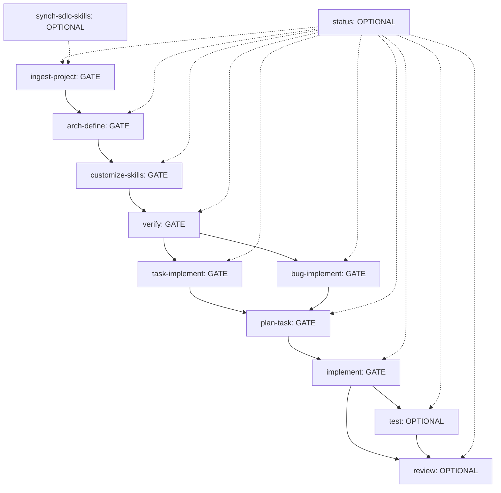

# Harness Flow Builder — Flow Documentation

This document describes the SDLC flow, gate semantics, and skill interactions for the Harness Flow Builder.

---

## Flow Overview

The harness defines a linear flow with two parallel branches (task and bug) after the verification gate:



---

## Phase Definitions

| Phase | Type | Description |
|-------|------|-------------|
| `ingest-project` | GATE | Scan a project (brownfield) or capture a new project description. Produces `wiki/project.md` and `wiki/features/*.md`. |
| `arch-define` | GATE | Define architecture, tech stack, module map, and key decisions. Produces `wiki/architecture.md` and `wiki/.harness/project_profile.md`. |
| `customize-skills` | GATE | Render common base skills (with `{{TOKENS}}`) into project-specific skills using the profile. Produces `wiki/.harness/skills/sdlc-*/SKILL.md`. |
| `verify` | GATE | Audit all wiki artifacts for `VERTIFY: STABLE`. Required artifacts must be STABLE to proceed. |
| `task-implement` | GATE | Convert a feature request into a structured task file (`wiki/tasks/task_*.md`). |
| `bug-implement` | GATE | Convert a bug report into a structured bug file (`wiki/bugs/bug_*.md`). |
| `plan-task` | GATE | Produce an implementation plan (`wiki/plans/plan_*.md`) from a task or bug. |
| `implement` | GATE | Execute the plan, modify source code, produce implementation report (`wiki/reports/implementation_*.md`). |
| `test` | OPTIONAL | Run tests against the implementation, produce test report (`wiki/reports/test_*.md`). |
| `review` | OPTIONAL | Review plan vs implementation vs tests, produce review report (`wiki/reports/review_*.md`). |
| `status` | OPTIONAL | Report current SDLC state (phase, active item, artifacts, next gate). Can run at any time. |
| `synch-sdlc-skills` | OPTIONAL | Sync base skills from upstream harness repo. Run when harness updates. |

---

## Gate Semantics

| Gate Type | Behavior |
|-----------|----------|
| **GATE** | Must complete successfully before the next phase. On failure: stay in current phase, fix input, retry. |
| **OPTIONAL** | May be skipped; reason must be logged in `.harness/current.md`. |

---

## Skill Contract

Every skill follows this contract:

1. **Pre-step verify** — Checks that must hold before running (e.g., required artifacts exist, tokens resolved).
2. **Input** — Consumes a filled input template (from `templates/input/*.md`).
3. **Execution** — Performs the skill's work.
4. **Output** — Produces artifacts per the output template (from `templates/output/*.md`).
5. **Next Step** — Declares `GATE` (required) or `OPTIONAL` (skippable).

---

## Two Tiers of Skills

| Tier | Location | Description |
|------|----------|-------------|
| **COMMON** | `skills/sdlc-*/SKILL.md` | Base skills containing `{{TOKENS}}` for customization. |
| **PROJECT** | `wiki/.harness/skills/sdlc-*/SKILL.md` | Rendered, project-specific skills. Used from `customize-skills` onward. |

---

## Artifact Locations

| Artifact | Path |
|----------|------|
| Flow definition | `.harness/flow.md` |
| Live state | `.harness/current.md` |
| Project profile | `wiki/.harness/project_profile.md` |
| Project doc | `wiki/project.md` |
| Feature docs | `wiki/features/*.md` |
| Architecture | `wiki/architecture.md` |
| Tasks | `wiki/tasks/task_*.md` |
| Bugs | `wiki/bugs/bug_*.md` |
| Plans | `wiki/plans/plan_*.md` |
| Reports | `wiki/reports/*.md` |
| Project skills | `wiki/.harness/skills/sdlc-*/SKILL.md` |

---

## Skill I/O Summary

| Skill | Consumes | Produces |
|-------|----------|----------|
| `sdlc-ingest-project` | path (brownfield) or description (new) | `wiki/project.md` + `wiki/features/*.md` |
| `sdlc-arch-define` | `project.md` + features | `wiki/architecture.md` + `wiki/.harness/project_profile.md` |
| `sdlc-customize-skills` | profile + base skills | `wiki/.harness/skills/sdlc-*/SKILL.md` |
| `sdlc-verify` | wiki artifacts | `wiki/reports/verify_*.md` |
| `sdlc-status` | `.harness/current.md` + wiki | `wiki/reports/status_*.md` |
| `sdlc-synch-sdlc-skills` | upstream harness repo | synced base skills + `wiki/reports/synch_*.md` |
| `sdlc-task-implement` | feature request | `wiki/tasks/task_*.md` |
| `sdlc-bug-implement` | bug report | `wiki/bugs/bug_*.md` |
| `sdlc-plan-task` | task or bug | `wiki/plans/plan_*.md` |
| `sdlc-implement` | plan | code + `wiki/reports/implementation_*.md` |
| `sdlc-test` | implementation report | `wiki/reports/test_*.md` |
| `sdlc-review` | plan + impl + tests | `wiki/reports/review_*.md` |

---

## Rules

1. **Only `sdlc-implement` edits source code.** All other skills produce documentation/artifacts.
2. **Every skill ends with a Pre-step verify and a Next Step** (GATE or OPTIONAL).
3. **From `customize-skills` onward, ALWAYS use PROJECT skills** (rendered in `wiki/.harness/skills/`).
4. **VERTIFY status** — Artifacts track `VERTIFY: DRAFT|STABLE`. The `verify` gate requires required artifacts to be `STABLE`.

---

## Entry Points

### Build the harness (in this repo)
```bash
./scripts/generate_source.sh
```
Writes `skills/`, `templates/`, `.harness/`, `README.md`, and `promt.sh` into CWD.

### Install into a target project
```bash
./scripts/generate_source.sh --install /path/to/project
```
Copies `skills/`, `templates/`, and `.harness/flow.md` into the target and seeds `.harness/current.md` only if missing. Never clobbers existing state.

### Ingest/reconcile harness in a target project
```bash
./scripts/generate_source.sh --ingest /path/to/project
```
Detects state (new vs existing), writes a reconcile plan, and applies after confirmation.

---

## Next Steps After Install

1. `sdlc-ingest-harness-flow` — (if not already done via `--install`)
2. `sdlc-ingest-project` — Scan the project or describe a new one
3. `sdlc-arch-define` — Define architecture and tech stack
4. `sdlc-customize-skills` — Render project-specific skills
4. `sdlc-verify` — Verify all required artifacts are STABLE
5. Then: `sdlc-task-implement` or `sdlc-bug-implement` → `sdlc-plan-task` → `sdlc-implement` → `sdlc-test` → `sdlc-review`