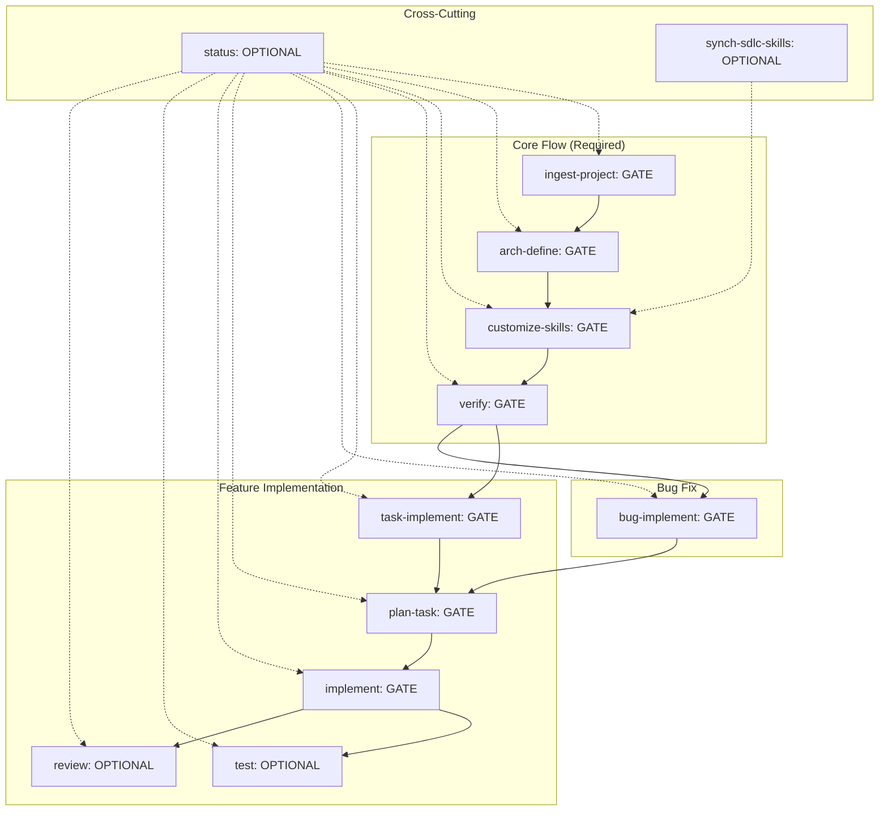

# Harness Flow - Detailed Flow Documentation

This document provides a detailed specification of the SDLC flow, gate semantics, and phase transitions.

---

## Flow Definition



---

## Phase Specifications

### 1. ingest-project (GATE)

**Purpose**: Decompose a project into a project doc plus one feature doc per capability.

**Pre-step Verify**:
- TYPE=brownfields → PROJECT_PATH exists and is readable
- TYPE=new → PROJECT_DESCRIPTION non-empty
- DOCS_ROOT creatable (run `./setup.sh` if missing)

**Input**: `templates/input/ingest_project_input.md`

**Output**: 
- `{{DOCS_ROOT}}/project.md`
- `{{DOCS_ROOT}}/features/feature_<snake_case_name>.md` (one per feature)

**Instructions**:
1. Brownfields → scan tree/README/manifests/entry points. New → use text.
2. Name the project (`{{PROJECT_NAME}}`); write a one-paragraph description.
3. List every distinct feature/capability.
4. Fill `templates/output/feature.md` per feature → `{{DOCS_ROOT}}/features/feature_<snake_case_name>.md`.
5. Fill `templates/output/project.md` → `{{DOCS_ROOT}}/project.md`.
6. Set `VERTIFY: DRAFT` on all new files.
7. Update `.harness/current.md`: PHASE=ingest-project, STATUS=DONE.

**Next Step**: GATE → `sdlc-arch-define` (required)

**Done When**:
- `{{DOCS_ROOT}}/project.md` lists every feature path on disk.
- Every feature doc matches the template.

---

### 2. arch-define (GATE)

**Purpose**: Turn ingested project + features into architecture.md and project_profile.md.

**Pre-step Verify**:
- project.md + all feature docs exist (from ingest-project)
- No unresolved Open Questions carried in

**Input**: `templates/input/arch_define_input.md`

**Output**:
- `{{DOCS_ROOT}}/architecture.md`
- `{{DOCS_ROOT}}/.harness/project_profile.md`

**Instructions**:
1. Read PROJECT_DOC + every FEATURE_DOC.
2. Fill `templates/output/architecture.md` (Tech Stack, Module Map, Data Flow, Key Decisions, Open Questions).
3. Fill `templates/output/project_profile.md` → `{{DOCS_ROOT}}/.harness/project_profile.md`. Commands must be exact.
4. Resolve or escalate every Open Question.
5. Flip project.md + feature docs to `VERTIFY: STABLE`.
6. Update `.harness/current.md`: PHASE=arch-define, STATUS=DONE.

**Next Step**: GATE → `sdlc-customize-skills` (required), then `sdlc-verify`

**Done When**:
- architecture.md + project_profile.md exist; profile commands run clean.
- Every feature maps to ≥1 module; profile `VERTIFY: STABLE`.
- No unresolved Open Questions.

---

### 3. customize-skills (GATE)

**Purpose**: Bridge COMMON and PROJECT. Substitutes every `{{TOKEN}}` in each base SKILL.md with the matching value from project_profile.md.

**Pre-step Verify**:
- project_profile.md exists and is `VERTIFY: STABLE`
- COMMON_SKILLS_DIR readable; TARGET_SKILLS_DIR writable
- No required command token (TEST_CMD/LINT_CMD/BUILD_CMD) left blank

**Input**: `templates/input/customize_skills_input.md`

**Output**: `./wiki/.harness/skills/sdlc-*/SKILL.md` (rendered)

**Instructions**:
1. Read PROFILE + ARCHITECTURE.
2. For each SKILL.md in COMMON_SKILLS_DIR:
   a. Replace every `{{TOKEN}}` (OVERRIDES win).
   b. SCOPE: common → SCOPE: project.
   c. Replace base warning with rendered-by notice + DATE.
   d. Write to TARGET_SKILLS_DIR/<name>/SKILL.md.
3. Fail if any `{{TOKEN}}` remains.
4. Update `.harness/current.md`: PHASE=customize-skills, STATUS=DONE, TARGET_SKILLS_DIR recorded.

**Next Step**: GATE → `sdlc-verify` (required)

**Done When**:
- Every base skill has a rendered copy.
- `grep -r '{{' TARGET_SKILLS_DIR` returns nothing.

---

### 4. verify (GATE)

**Purpose**: Validate wiki artifacts for consistency and completeness.

**Pre-step Verify**:
- All previous phase outputs exist
- project_profile.md is `VERTIFY: STABLE`

**Input**: `templates/input/verify_input.md`

**Output**: `wiki/reports/verify_*.md`

**Instructions**:
1. Read all wiki artifacts (project.md, features/*, architecture.md, project_profile.md).
2. Run validation checks:
   - All feature docs referenced in project.md exist
   - All modules in architecture.md have corresponding source paths
   - project_profile.md commands are executable
   - No `{{TOKEN}}` remains in rendered skills
   - Cross-references are valid
3. Write report to `wiki/reports/verify_<timestamp>.md`.
4. Update `.harness/current.md`: PHASE=verify, STATUS=DONE.

**Next Step**: GATE → `sdlc-task-implement` or `sdlc-bug-implement` (required)

**Done When**:
- Verification report exists with PASS/FAIL for each check.
- All critical checks pass.

---

### 5. task-implement (GATE)

**Purpose**: Convert a feature request into a structured task specification.

**Pre-step Verify**:
- verify phase passed
- Feature exists in project.md/features/

**Input**: `templates/input/task_implement_input.md`

**Output**: `wiki/tasks/task_<name>.md`

**Instructions**:
1. Read feature request from input.
2. Match to existing feature in project.md.
3. Fill `templates/output/task.md` → `wiki/tasks/task_<snake_case_name>.md`.
4. Include: acceptance criteria, scope, dependencies, priority.
5. Update `.harness/current.md`: PHASE=task-implement, STATUS=DONE.

**Next Step**: GATE → `sdlc-plan-task` (required)

**Done When**:
- Task spec exists and references a valid feature.
- Acceptance criteria are testable.

---

### 6. bug-implement (GATE)

**Purpose**: Convert a bug report into a structured bug specification.

**Pre-step Verify**:
- verify phase passed
- Bug is reproducible or has clear reproduction steps

**Input**: `templates/input/bug_implement_input.md`

**Output**: `wiki/bugs/bug_<name>.md`

**Instructions**:
1. Read bug report from input.
2. Fill `templates/output/bug.md` → `wiki/bugs/bug_<snake_case_name>.md`.
3. Include: reproduction steps, expected vs actual, severity, affected components.
4. Update `.harness/current.md`: PHASE=bug-implement, STATUS=DONE.

**Next Step**: GATE → `sdlc-plan-task` (required)

**Done When**:
- Bug spec exists with clear reproduction steps.
- Affected components map to modules in architecture.md.

---

### 7. plan-task (GATE)

**Purpose**: Create an implementation plan from a task or bug.

**Pre-step Verify**:
- Task or bug spec exists (from task-implement or bug-implement)
- Architecture.md defines relevant modules

**Input**: `templates/input/plan_task_input.md`

**Output**: `wiki/plans/plan_<name>.md`

**Instructions**:
1. Read task/bug spec + architecture.md + project_profile.md.
2. Fill `templates/output/plan.md` → `wiki/plans/plan_<snake_case_name>.md`.
3. Include: approach, files to change, test strategy, risk assessment, rollback plan.
4. Reference specific modules and functions from architecture.md.
5. Update `.harness/current.md`: PHASE=plan-task, STATUS=DONE.

**Next Step**: GATE → `sdlc-implement` (required)

**Done When**:
- Plan exists with concrete file-level changes.
- Test strategy references TEST_CMD from project_profile.md.
- Risk assessment covers rollback.

---

### 8. implement (GATE)

**Purpose**: Execute the plan and produce code changes + implementation report.

**Pre-step Verify**:
- Plan exists and is approved
- BUILD_CMD and TEST_CMD from project_profile.md work

**Input**: `templates/input/implement_input.md`

**Output**: 
- Source code changes (only skill that edits source)
- `wiki/reports/implementation_<name>.md`

**Instructions**:
1. Read plan + project_profile.md.
2. Execute changes per plan.
3. Run BUILD_CMD to verify compilation.
4. Fill `templates/output/implementation.md` → `wiki/reports/implementation_<name>.md`.
5. Include: files changed, commands run, build output, deviations from plan.
6. Update `.harness/current.md`: PHASE=implement, STATUS=DONE.

**Next Step**: 
- OPTIONAL → `sdlc-test`
- OPTIONAL → `sdlc-review`

**Done When**:
- Code changes match plan (or deviations documented).
- BUILD_CMD passes.
- Implementation report complete.

---

### 9. test (OPTIONAL)

**Purpose**: Run tests and document results.

**Pre-step Verify**:
- Implementation report exists
- TEST_CMD from project_profile.md defined

**Input**: `templates/input/test_input.md`

**Output**: `wiki/reports/test_<name>.md`

**Instructions**:
1. Read implementation report.
2. Run TEST_CMD (and LINT_CMD if defined).
3. Fill `templates/output/test_report.md` → `wiki/reports/test_<name>.md`.
4. Include: test command, output, pass/fail, coverage, new tests added.
5. Update `.harness/current.md`: PHASE=test, STATUS=DONE (or SKIPPED with reason).

**Next Step**: OPTIONAL → `sdlc-review`

**Done When**:
- Test report exists with results.
- If skipped, reason logged in `.harness/current.md`.

---

### 10. review (OPTIONAL)

**Purpose**: Review plan + implementation + tests for quality.

**Pre-step Verify**:
- Implementation report exists
- Test report exists (or test was skipped with reason)

**Input**: `templates/input/review_input.md`

**Output**: `wiki/reports/review_<name>.md`

**Instructions**:
1. Read plan + implementation report + test report.
2. Fill `templates/output/review.md` → `wiki/reports/review_<name>.md`.
3. Include: code quality, adherence to plan, test adequacy, security concerns, approval decision.
4. Update `.harness/current.md`: PHASE=review, STATUS=DONE (or SKIPPED with reason).

**Next Step**: (End of feature/bug flow)

**Done When**:
- Review report exists with approval decision.
- If skipped, reason logged in `.harness/current.md`.

---

### 11. status (OPTIONAL - Any Time)

**Purpose**: Generate a status snapshot of the current flow state.

**Pre-step Verify**: None (can run anytime)

**Input**: `templates/input/status_input.md`

**Output**: `wiki/reports/status_<timestamp>.md`

**Instructions**:
1. Read `.harness/current.md` + all wiki artifacts.
2. Fill `templates/output/status_report.md` → `wiki/reports/status_<timestamp>.md`.
3. Include: current phase, active item, completed phases, blockers, next actions.
3. Update `.harness/current.md` with latest status.

**Next Step**: (Returns to current phase)

**Done When**: Status report generated.

---

### 12. synch-sdlc-skills (OPTIONAL - On Harness Update)

**Purpose**: Sync common base skills from upstream harness repo.

**Pre-step Verify**:
- Upstream harness repo accessible
- No local uncommitted changes to common skills

**Input**: `templates/input/synch_sdlc_skills_input.md`

**Output**: 
- Updated common skills in `skills/sdlc-*/`
- `wiki/reports/synch_<timestamp>.md`

**Instructions**:
1. Fetch upstream harness repo.
2. Compare common skills (skills/sdlc-*/SKILL.md).
3. For each changed skill:
   a. Backup current version.
   b. Apply upstream changes.
   c. Re-run `sdlc-customize-skills` to re-render project skills.
4. Fill `templates/output/synch_report.md` → `wiki/reports/synch_<timestamp>.md`.
5. Include: skills updated, conflicts resolved, re-customization status.

**Next Step**: GATE → `sdlc-customize-skills` (required after sync)

**Done When**:
- Common skills match upstream.
- Project skills re-rendered successfully.
- Sync report documents all changes.

---

## Gate Semantics

| Symbol | Meaning |
|--------|---------|
| **GATE** | Must complete before next phase. Fail → stay, fix input, retry. |
| **OPTIONAL** | May be skipped; log the reason in `.harness/current.md`. |

---

## Skill Execution Rules

1. **Only `sdlc-implement` edits source code**. All other skills produce documentation/artifacts only.

2. **Every skill ends with**:
   - Pre-step verify: checks that must hold before running.
   - Next Step: GATE (required) or OPTIONAL (skippable).

3. **Two tiers of skills**:
   - COMMON → `skills/sdlc-*/SKILL.md` (contain `{{TOKENS}}`)
   - PROJECT → `./wiki/.harness/skills/sdlc-*/SKILL.md` (rendered)
   - From `customize-skills` onward, **ALWAYS use PROJECT skills**.

4. **Token substitution**: All `{{TOKENS}}` in common skills are replaced by values from `project_profile.md`. OVERRIDES in profile take precedence.

5. **Verification**: Each skill validates its preconditions before executing. Failures block progression.

---

## Artifact Lifecycle

```
ingest-project
  ├── project.md (DRAFT → STABLE after arch-define)
  └── features/feature_*.md (DRAFT → STABLE after arch-define)

arch-define
  ├── architecture.md
  └── .harness/project_profile.md (VERTIFY: STABLE)

customize-skills
  └── .harness/skills/sdlc-*/SKILL.md (rendered, no tokens)

verify
  └── reports/verify_*.md

task-implement / bug-implement
  └── tasks/task_*.md OR bugs/bug_*.md

plan-task
  └── plans/plan_*.md

implement
  └── reports/implementation_*.md + source changes

test (OPTIONAL)
  └── reports/test_*.md

review (OPTIONAL)
  └── reports/review_*.md

status (OPTIONAL)
  └── reports/status_*.md

synch-sdlc-skills (OPTIONAL)
  └── reports/synch_*.md + updated common skills
```

---

## Error Handling

| Scenario | Action |
|----------|--------|
| Pre-step verify fails | Block phase, log error in `.harness/current.md`, fix input, retry |
| Token remains after customize-skills | Fail phase, report unresolved tokens |
| Verification fails | Block progression, fix artifacts, re-run verify |
| Implementation deviates from plan | Document in implementation report, reviewer decides |
| Test fails | Document in test report, return to implement or plan-task |
| Review rejects | Return to implement with review feedback |

---

## State Machine

```
PENDING → IN_PROGRESS → DONE
                ↓
             BLOCKED (fix input, retry)
                ↓
             SKIPPED (OPTIONAL only, log reason)
```

Each phase in `.harness/current.md` tracks its own status independently.